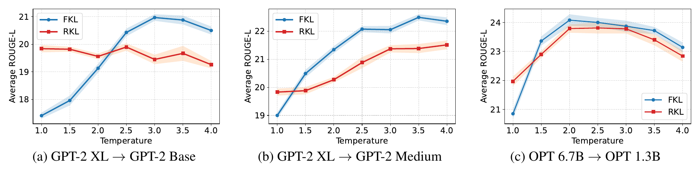

<div align="center">

# Rethinking the Role of Temperature<br>in Large Language Model Distillation

[Hoang-Chau Luong](https://scholar.google.com/citations?hl=en&user=j4ck-L4AAAAJ) · [Lingwei Chen](https://scholar.google.com/citations?user=CnKs0mEAAAAJ&hl=en)<br>
Rochester Institute of Technology


[](LICENSE)

</div>

> **TL;DR** Reverse KL (RKL) is usually preferred over forward KL (FKL) for LLM distillation, but
> only because the two are compared at KD temperature τ = 1. Tune τ and **FKL overtakes RKL**, and
> **every KL-based objective gets better**.

<p align="center">
  
  <br>
  <em>Average ROUGE-L over five benchmarks. Temperature consistently improves FKL but helps RKL far less.</em>
</p>

**Why?** Both distributions are softened as softmax(z / τ).

- **FKL** matches the softened teacher directly, so a higher τ reveals the non-target tokens it learns from. Temperature changes *what* FKL learns.
- **RKL** follows teacher–student logit gaps weighted by the student, so τ mostly rescales its gradient. Temperature changes *how* RKL learns.

## ✨ Results

Average ROUGE-L on Dolly, Super-NI and UnNI (Table 2), going from **τ = 1** to the **best τ** in {1.5, …, 4.0}:

| Objective | GPT-2 XL → GPT-2 Base | OPT 6.7B → OPT 1.3B |
|:--|:-:|:-:|
| FKL | 19.70 → **25.53** (↑5.83) | 25.00 → **29.08** (↑4.08) |
| RKL | 23.21 → **23.70** (↑0.49) | 25.17 → **28.63** (↑3.46) |
| Sym-KL | 22.17 → **24.17** (↑2.00) | 24.86 → **29.23** (↑4.37) |
| JS | 21.97 → **25.63** (↑3.66) | 25.67 → **29.48** (↑3.81) |
| SFKL | 23.31 → **25.60** (↑2.29) | 25.25 → **28.98** (↑3.73) |
| SRKL | 23.91 → **24.70** (↑0.79) | 24.57 → **29.24** (↑4.67) |
| AKL | 18.43 → **25.05** (↑6.62) | 24.74 → **29.62** (↑4.88) |
| *AB / DRKL (τ = 1)* | *23.91 / 25.16* | *25.96 / 27.71* |

## 🚀 Quick start

```bash
pip install -r requirements.txt

# 1. download the benchmarks and checkpoints, tokenize Dolly
bash scripts/prepare_data.sh gpt2

# 2. distill GPT-2 XL into GPT-2 Base with FKL at τ = 3
bash scripts/train.sh gpt2-base fkl 3.0

# 3. ROUGE-L on 5 benchmarks x 5 seeds
bash scripts/eval.sh gpt2-base results/gpt2-base/fkl-tau3.0-seed10/best_rougeL
```

## 🧪 Usage

```bash
bash scripts/train.sh <config> <loss> [tau] [seed] [extra args]
bash scripts/eval.sh  <config> <checkpoint>
```

| `<config>` | Teacher → Student | Fine-tuning |
|:--|:--|:-:|
| `gpt2-base` | GPT-2 XL (1.5B) → GPT-2 Base (120M) | full |
| `gpt2-medium` | GPT-2 XL (1.5B) → GPT-2 Medium (340M) | full |
| `opt-1.3b` | OPT 6.7B → OPT 1.3B | full |
| `llama3-1b` | Llama-3.2-3B → Llama-3.2-1B | LoRA |
| `qwen3-1.7b` | Qwen3-4B → Qwen3-1.7B | LoRA |

| `<loss>` | Objective |
|:--|:--|
| `fkl`, `rkl` | forward KL(p‖q), reverse KL(q‖p) |
| `symkl` | Sym-KL: 0.5 · FKL + 0.5 · RKL |
| `js` | generalized Jensen–Shannon, λ = 0.9 ([Agarwal et al., 2024](https://arxiv.org/abs/2306.13649)) |
| `sfkl`, `srkl` | skewed FKL / RKL, α = 0.1 ([Ko et al., 2024](https://arxiv.org/abs/2402.03898)) |
| `akl` | adaptive KL ([Wu et al., 2025](https://arxiv.org/abs/2404.02657)) |
| `ab` | α-β divergence, α = 0.2, β = 0.7 ([Wang et al., 2025](https://arxiv.org/abs/2505.04560)) |
| `drkl` | diversity-aware RKL ([Luong et al., 2026](https://arxiv.org/abs/2604.00223)) |
| `sft` | plain fine-tuning, no teacher |

- The GPT-2 XL and OPT 6.7B teachers are downloaded already fine-tuned. Fine-tune the Llama and Qwen teachers first with `bash scripts/train.sh llama3-3b sft` (or `qwen3-4b`).
- Add `--on-policy` to train on student-generated samples, using DistiLLM's adaptive schedule.

<details>
<summary><b>Training details</b></summary>

- Global batch size of 32 on any number of GPUs; gradient accumulation is set automatically. The paper used 4 × A100 (40 GB).
- GPT-2 and OPT: full fine-tuning for 20 epochs, max length 512, learning rate 5e-4 (GPT-2) or 5e-5 (OPT).
- Llama and Qwen: LoRA (r = 16, α = 32), max length 1024.
- After every epoch the student is scored on held-out Dolly examples (1,000; 200 for LoRA). The checkpoint with the best ROUGE-L is kept.
- Evaluation samples at temperature 1 with seeds 10–50 and reports ROUGE-L mean ± std. Use `BENCHMARKS="dolly vicuna"` or `SEEDS=10` to run a subset.

</details>

## 📊 Reproducing the paper

```bash
CONFIG=gpt2-base   # gpt2-medium | opt-1.3b | llama3-1b | qwen3-1.7b
for loss in fkl rkl symkl js sfkl srkl akl; do
  for tau in 1.0 1.5 2.0 2.5 3.0 3.5 4.0; do
    bash scripts/train.sh $CONFIG $loss $tau
    bash scripts/eval.sh  $CONFIG results/$CONFIG/$loss-tau$tau-seed10/best_rougeL
  done
done
```

| In the paper | How to run |
|:--|:--|
| Figure 1 | the loop with `fkl rkl` on `gpt2-base`, `gpt2-medium`, `opt-1.3b` |
| Table 1 (on-policy) | `bash scripts/train.sh gpt2-base fkl <tau> 10 --on-policy`, same for `rkl` |
| Tables 2, 5 and Figure 2 | the loop on `gpt2-base` and `opt-1.3b`, plus the losses `ab` and `drkl` at τ = 1 |
| Tables 6, 7 | `train.sh llama3-3b sft` (`qwen3-4b sft`), then the loop on `llama3-1b` (`qwen3-1.7b`) |
| Teacher rows | `eval.sh gpt2-base checkpoints/gpt2-xl`, `eval.sh opt-1.3b checkpoints/opt-6.7b` |

<details>
<summary><b>Repository structure</b></summary>

```
├── finetune.py           SFT and distillation; keeps the best checkpoint by validation ROUGE-L
├── evaluate.py           sampling and ROUGE-L on one benchmark
├── distillm/
│   ├── losses.py         all distillation objectives
│   ├── sampler.py        student sampling for on-policy training
│   └── buffer.py         replay buffer of student samples
├── data_utils/           tokenized training data and evaluation prompts
├── scripts/
│   ├── prepare_data.sh   download and tokenize
│   ├── train.sh          train one model
│   ├── eval.sh           evaluate one checkpoint
│   └── configs/          one file per teacher → student pair
├── tools/                Dolly tokenization, result summary
├── configs/deepspeed/    ZeRO-1 fp16 (GPT-2, OPT), ZeRO-2 bf16 (Llama, Qwen)
└── tests/                CPU tests: python -m pytest tests
```

</details>

## 🙏 Acknowledgements

Built on [MiniLLM](https://github.com/microsoft/LMOps/tree/main/minillm) and [DistiLLM](https://github.com/jongwooko/distillm).
This work is partially supported by the NSF under grant CNS-2549995 and by Research Computing at the Rochester Institute of Technology.

## 📝 Citation

```bibtex
@inproceedings{luong2026rethinking,
  title     = {Rethinking the Role of Temperature in Large Language Model Distillation},
  author    = {Luong, Hoang-Chau and Chen, Lingwei},
  booktitle = {Proceedings of the 2026 Conference on Empirical Methods in Natural Language Processing},
  year      = {2026}
}
```
